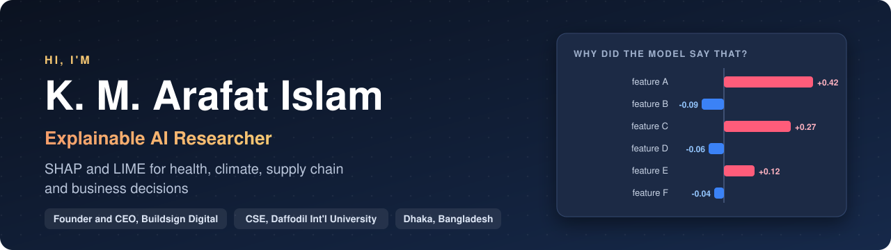
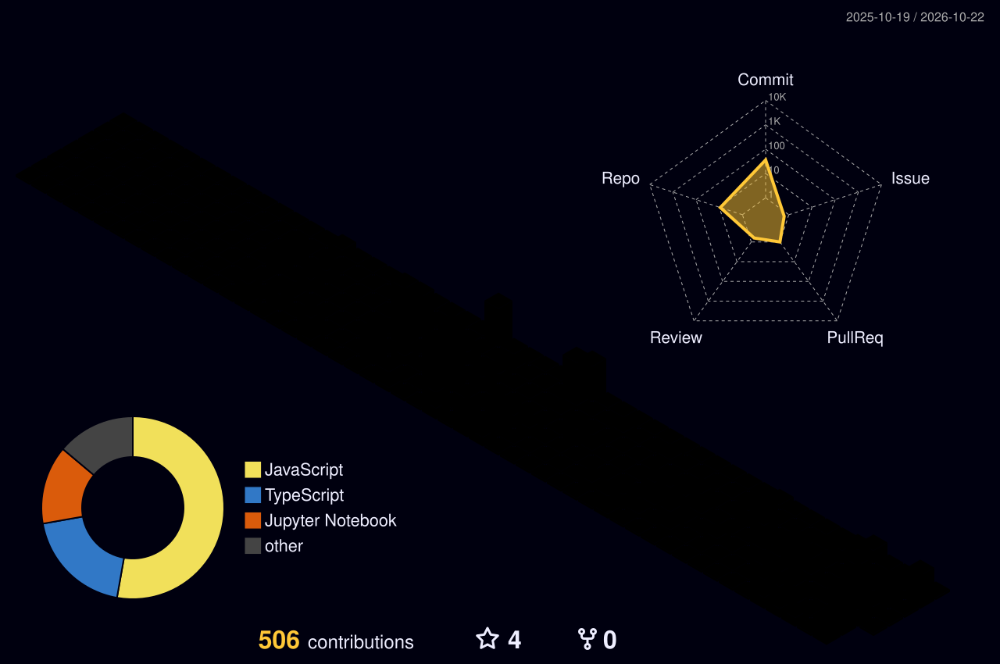

  

  
  
  

---

<h2 align="center">🧊 My GitHub, in 3D</h2>

  <picture>
    <source media="(prefers-color-scheme: dark)" srcset="profile-3d-contrib/profile-night-rainbow.svg">
    <source media="(prefers-color-scheme: light)" srcset="profile-3d-contrib/profile-green-animate.svg">
    
  </picture>

Rebuilt every day from my contribution history.

---

## About me

I build machine learning models that have to **explain themselves**. Most of my work pairs ensemble and gradient boosting models with **SHAP** and **LIME**, so the people making decisions in health, climate, supply chain, retail and HR can see *why* a model says what it says.

<table>
  <tr>
    <td>🔬 <b>Researching</b></td>
    <td>Explainable AI (SHAP, LIME) for socioeconomic and business data</td>
  </tr>
  <tr>
    <td>🏢 <b>Building</b></td>
    <td>Buildsign Digital, a digital agency (Founder and CEO)</td>
  </tr>
  <tr>
    <td>💼 <b>Working at</b></td>
    <td>Ostad</td>
  </tr>
  <tr>
    <td>🎓 <b>Studied</b></td>
    <td>B.Sc. in Computer Science and Engineering, Daffodil International University</td>
  </tr>
  <tr>
    <td>🌱 <b>Next</b></td>
    <td>Funded master's study in Data Science and Business Analytics</td>
  </tr>
</table>

## 📄 Research in 2026

| Venue | Paper | Status |
|---|---|:---:|
| **IEEE CSDE 2026** | Ensemble-Based Detection of Global Climate Anomalies Using Surface Temperature and CO₂ Emission Indicators: A Majority-Voting Unsupervised Framework with SHAP Interpretability | ✅ Accepted |
| **IEEE CSDE 2026** | [Global Diabetes Mortality Analysis: A Reproducible WHO Data-Driven Study of Trends, Regional Disparities, and Prevalence-Mortality Relationships (2000–2014)](https://github.com/noobarafat/Global_Diabetes_Mortality_Analysis-IEEE_CSDE_2026_5586-) | ✅ Accepted |
| **IEEE i-COSTE 2026** | Sector-Level Emission Intensity Profiling of Supply Chains: A Leakage-Free Machine Learning Approach Using Structurally Independent Predictors | ✅ Accepted |
| **IEEE WIECON-ECE 2026** | UERAF: A Unified Framework for E-Commerce Return Prediction, Root Cause Analysis, and Revenue Impact Simulation | ✅ Accepted |
| **COMPAS 2026** | Targeting the Persuadable: A Causal Uplift Framework for Budget-Constrained Retail Campaign Optimization | ✅ Accepted |
| **iCACCESS 2026** | An Interpretable Ensemble Learning Framework for Predicting Students' Entrepreneurial Intention in Digital Entrepreneurship Education | 🎤 Presented |

## ⭐ Featured project

**[Research Paper Humanizer](https://github.com/noobarafat/research-paper-humanizer)** is an evidence-based Claude skill that rewrites AI-assisted research papers so they read as author-written. It lowers Turnitin, GPTZero and Originality.ai scores while keeping every number, citation and technical term unchanged. It is built on peer-reviewed studies of how LLMs write science.

## 🧰 Toolkit

**Machine learning and XAI**

  
  
  
  
  
  
  
  

**Data and analysis**

  
  
  
  
  
  
  
  
  

**Design and build**

  
  
  
  
  

## 🏆 Highlights

<table>
  <tr>
    <td align="center" width="25%">📡 <b>Featured by</b> Grameenphone</td>
    <td align="center" width="25%">📱 <b>Govt.-certified</b> mobile app developer (EDGE)</td>
    <td align="center" width="25%">🎨 <b>Fiverr Level 1</b> UI/UX designer</td>
    <td align="center" width="25%">🤝 <b>100+ events</b> organized and volunteered</td>
  </tr>
</table>

---

  <i>Open to research collaborations in explainable AI, applied ML and business analytics.</i> 
  <a href="mailto:kmarafatislam@gmail.com">Get in touch</a>

